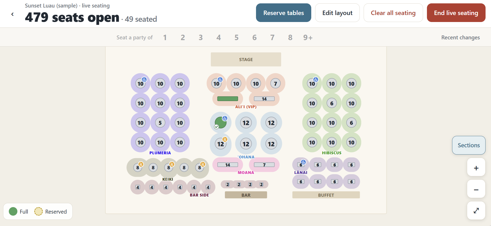
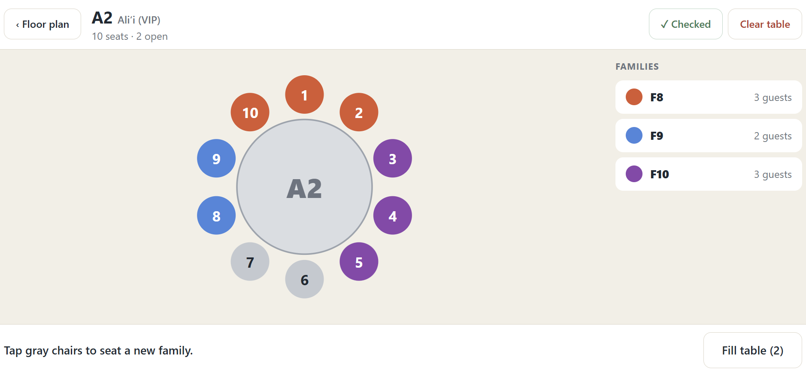

# Luau Seating

A tablet-first floor plan and live seating app for restaurants and event venues. It was built first for a Hawaii luau that seats about 500 guests across 528 chairs, where seating mistakes are costly: a room can have plenty of empty chairs and still have nowhere to seat a family together. Hostesses see the whole floor at a glance, seat walk-in families chair by chair, manage multi-table reservations, and share one live view of the room across several tablets, with double-booking prevented by the database itself.





## Features

- **Live floor plan:** gray tables show how many seats are left; green tables are full. Reserved tables show the party's name.
- **Seat counter:** shows empty chairs left and "spare" seats (empty chairs minus guests still expected), so staff can see when leftover single chairs start eating into the buffer.
- **Chair-by-chair seating:** tap a table, tap the chairs for a party, press Done. Each family gets its own color, and several families can share a table.
- **Reservations:** a named party can hold one or more tables; one tap marks the whole party as seated.
- **Fast corrections from a second device:** a floor lead can move a family to another table, add or remove a seat, mark a family as left, and spot-check tables against the real floor. A "Recent changes" list shows what other devices changed.
- **Real-time sync:** every change appears on all signed-in devices within about a second.
- **Double-booking protection:** if two tablets tap the same chair at once, the database accepts only one and the other is told the chair was just taken.
- **Clearing and resets:** clear one table during service, or reset the whole event while keeping the saved floor plan.
- **Staff login:** only staff accounts created by the restaurant can access its data.

## Tech stack

- **Front end:** React, TypeScript, Vite
- **Backend:** Supabase (PostgreSQL, real-time subscriptions, authentication, Row Level Security)
- **Tooling:** ESLint, Git and GitHub

## How it works

The floor plan is drawn from data: a saved layout describes every table, chair and section, and each day's event is an editable copy of that layout. Seating changes are never shown "optimistically": the app sends each change to the database and only updates the screen once the database accepts it. A uniqueness rule in the database allows each chair to be assigned only once per event, so even if two tablets act at the same moment, only one assignment succeeds. Every tablet subscribes to database changes and reloads affected tables in real time, and Row Level Security ensures each restaurant's staff can only see and change their own data.

## Running it locally

1. Clone the repository and install dependencies:
   ```
   git clone https://github.com/Lannami-04/seating-app.git
   cd seating-app
   npm install
   ```
2. Create a free [Supabase](https://supabase.com) project.
3. Copy `.env.example` to `.env.local` and fill in your project's URL and publishable key. Never commit `.env.local`.
4. In the Supabase SQL Editor, run each file in `supabase/migrations/` in order.
5. In Supabase, create a staff user under Authentication, and turn off public sign-ups.
6. Start the app:
   ```
   npm run dev
   ```
   To test from a phone or tablet on the same Wi-Fi, use `npm run dev -- --host` and open the Network address it prints.

## Status

Preparing for an on-site trial at the luau. Next steps: deploying online, testing on the venue's tablets, and comparing the app against the real floor during a trial service.

## About

Built by Lanna Eleazar, a computer science student, as a real tool for the restaurant where I work. I gathered the requirements from day-to-day seating problems and tested the app on real devices. [LEARNING.md](LEARNING.md) walks through how the codebase is organized.